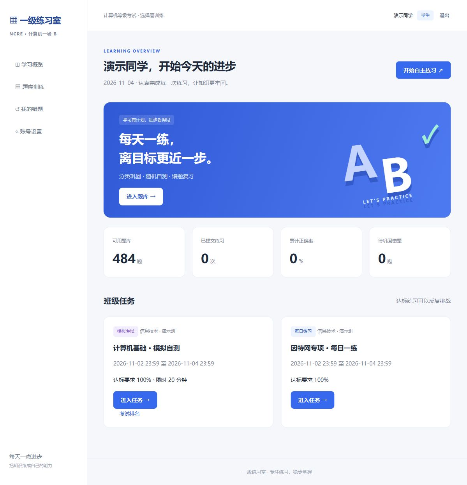

# 一级练习室

面向计算机一级 B 选择题训练的轻量 Web 应用。Flask + SQLite + 原生 JavaScript，单个 Docker 容器，无需 Node 构建、Redis 或独立数据库。



## 已实现

- 管理员、班主任、学生三种角色；班主任仅能管理本人班级，管理员可查看所有班级。
- 新建班级时创建专属班主任账号；单独添加学生或 Excel 批量导入。
- 管理员及对应班主任可在班级中修改学生姓名、学号和班级；班主任仅可转入自己管理的班级，管理员可跨班调整。学号或班级变更后旧会话失效，原密码和答卷保留。删除学生后立即停用登录，并从当前名单、进度中移除，可在“学生回收站”恢复。已删除账号的学号仍保留，避免成绩混入另一个人；恢复后可按需重置密码。
- 学生初始密码为 `123456`，班主任账号使用随机初始密码；首次登录强制改密、班主任重置本班学生密码、改密后旧会话失效、CSRF 防护、登录失败限流、操作记录。
- 10 个分类：从原始 Word 识别 520 条记录，完全相同记录去重后实际可用 484 题。保留原始答案与解析，不自动纠正内容。
- 管理员可在“题库训练 → 新增题目”手动填写分类、题干、A–D选项、正确答案与解析，也可继续使用 Word 批量导入。展开题目可删除，误删可在回收站恢复；删除后不再用于新组题，已经发布的任务、进行中的试卷和历史成绩保留原题。题目管理操作写入日志，班主任与学生不能增删全校题库。
- 分类随机训练、全题库随机训练，题量可设 1–100。提交整组题目后显示解析。
- 班级每日练习：随机固定组题或手选题，设置开放时间和达标率（默认100%）。可重复做，必须单次达到设定正确率；一旦达标，后续低分不会撤销完成状态。
- 每日练习支持修改、删除及回收站恢复。无人开始作答时可修改名称、时间、题目和达标率；已有作答后锁定题目及达标率，仍可改名称和时间，更换题组请重新发布。删除后不再显示于学生任务列表，也不能开启新作答；已打开的答卷可继续提交，历史成绩保留。模拟考同样支持删改，开考后的修改限制见文末。
- 自动错题归档，再次答对标记已掌握，再次出错重新纳入复习。
- 教师进度页每10秒更新，包含未开始、作答中、待达标、已达标，支持 CSV 导出。
- 模拟考试：服务器计时、单次作答、答题自动保存、超时以已保存答案交卷，统一结束前不公开解析或学生排名；按正确数、用时排名。
- 手机与桌面自适应界面、在线一致性备份脚本。

## Docker 部署

服务器安装 Docker Engine 与 Compose 插件后：

```bash
git clone https://github.com/warmingkkk/ncre-practice.git
cd ncre-practice
cp .env.example .env
```

编辑 `.env`：把 `ADMIN_PASSWORD` 设置为自己的强密码（至少10位）。默认监听 `127.0.0.1:8080`，适合在前面放已有 Nginx / Caddy。然后：

```bash
docker compose up -d --build
docker compose ps
docker compose logs --tail 100 web
```

登录账号为 `admin`，初始密码为 `.env` 中的 `ADMIN_PASSWORD`。首次登录必须更改。环境变量只在首次创建管理员时生效，后续修改环境变量不会重置密码。

### 管理员无法登录时的恢复

更新不会把管理员密码改回 `.env`。如果新密码和初始密码都不可用，请在服务器的项目目录运行只读检查：

```bash
docker compose exec web python scripts/admin_access.py status
```

输出只包含管理员状态、锁定剩余时间、当前环境密码是否匹配以及记录数量，不输出密码或密码哈希。若班级、用户或答卷数量明显不对，先检查是否挂载了原来的 `practice-data` 数据卷。

确认是正确的数据库后，可将管理员密码恢复为**容器当前配置的 `ADMIN_PASSWORD`**：

```bash
docker compose exec web python scripts/admin_access.py reset --from-env
```

也可省略 `--from-env`，在终端交互输入新的10–128位临时密码（输入不回显）。工具会先在线备份数据库，再重设现有管理员密码、清除其登录失败锁定并使旧会话失效；班级、学生和成绩保留。登录后必须再次修改密码。它不创建新数据库、不创建账号、不提升教师或学生权限，也不提供网页恢复接口。**不要用删除数据卷或重新初始化的方式恢复登录。**

内网临时访问可把 `BIND_ADDRESS` 改成 `0.0.0.0`，用 `http://服务器IP:8080` 访问。正式给学生使用时配置域名和 HTTPS，把 `COOKIE_SECURE=1` 后重建服务：

```bash
docker compose up -d
```

已有 Caddy 可采用下面的站点配置（替换域名）：

```caddyfile
practice.example.com {
    reverse_proxy 127.0.0.1:8080
}
```

容器默认非 root、应用内存上限512MB，数据保存在 Docker 命名卷 `practice-data`，日志轮转。镜像升级不会清空数据。不要执行 `docker compose down -v`，该命令会删除数据卷。

## 第一次使用

1. 管理员新建班级，填写班主任姓名和登录账号；可指定10–128位初始密码，留空则随机生成。保存创建完成页显示的实际密码。**班主任初始密码不使用学生的 `123456`**。忘记时，管理员进入“系统管理”，在该班主任账号旁填写新初始密码并重置，留空则生成随机密码。班主任首次登录后先进入改密页，完成后才能进入班级。
2. 管理员或班主任进入班级，上传学生名单。**兼容当前目录文件的两列“学号、姓名”**，班级由上传位置确定。也支持“班级、学号、姓名”三列，班级名需完全匹配当前班级。多班级名单请按班拆分。
3. 学生账号为学号，单独新建和批量导入的初始密码均为 `123456`，首次登录必须修改。学生忘记密码时，管理员或本班班主任可在班级学生名单中点击“重置为123456”；重置会清除登录失败锁定、使旧会话失效，并要求再次改密。导入完成页可打印/保存 PDF。已经存在的同班学号跳过，不覆盖密码。任何一条发生冲突则整批回滚。
4. 在班级发布任务，可从分类随机抽题，也可展开手动选题；全班使用相同的一组题目。
5. 学生登录，首次改密后进入任务。未点击任务时显示“未作答”，进入任务后为“作答中”，提交后按成绩显示“待达标”或“已达标”；学生首页与教师进度页使用相同状态。每日练习可反复做；教师打开完成情况页即可持续查看。

Excel 学号建议存为文本，避免 Excel 在保存前就丢失前导零。名单、密码、生产数据库均在 `.gitignore` / `.dockerignore` 中排除。当前目录42人真实名单已验证能解析，没有上传 GitHub，也没有写入演示数据库。

## 多人使用与资源

8 个 Waitress 工作线程 + SQLite WAL + 索引和短事务。每题选择在700毫秒后合并保存，无 WebSocket 长连接、无学生端轮询。教师查看的班级页面每10秒查询一次。

本地 Windows 隔离 HTTP 压测：300 名虚拟学生同时进入，完成读题、保存、交卷与概览查询，共1,800个请求，300份满分答卷全部入库，零错误。第一轮约9.71秒完成，P95约1.92秒。最新结果见 `load-test-result.json`。此测试使用预签名会话，**不包含同时登录时的密码哈希、TLS和公网延迟，也不是2GB服务器实测**。2GB/1核服务器上线后应在目标机器复跑压测；512MB是配置上限，不是测得的内存峰值。

另做了包含真实密码校验的集中登录测试：300 人同时登录并完成练习，共2,400个请求、300份成功提交、零错误，耗时19.53秒，P95约6.96秒。报告见 `load-test-login-result.json`，复跑命令 `python scripts/load_test.py --users 300 --login`。集中登录时密码哈希会带来排队，建议学生提前登录后再统一开始考试。

GitHub Actions 已验证 Docker 镜像构建、512MB/1核限制下启动与健康检查；空闲容器内存约35.69MiB，此值不代表考试峰值。首轮验证记录见 [CI运行结果](https://github.com/warmingkkk/ncre-practice/actions/runs/41670390683)。

SQLite WAL 支持读写并行，但写事务仍串行，数据库卷需要本机磁盘，不要放在网络文件系统。见 [SQLite 官方说明](https://www.sqlite.org/wal.html)。应用通过生产 WSGI 服务运行，见 [Flask 部署说明](https://flask.palletsprojects.com/en/stable/deploying/)。

本应用适合几百人班级训练。若未来持续高频并发写入、扩展多台应用实例，可迁移 PostgreSQL，当前无需先部署额外数据库。

## 备份与恢复

在线备份会把 WAL 中已经提交的数据一并写入一致性快照：

```bash
docker compose exec web python scripts/backup.py
docker compose cp web:/app/data/backup-实际时间.sqlite3 ./backup.sqlite3
```

备份文件包含学生和成绩，请另存到私有位置。建议服务器每天执行一次，并将副本复制到另一台设备。

恢复前先停机，并保留当前数据卷备份。把要恢复的文件复制进已停止的容器，移除旧 WAL / SHM，再启动：

```bash
docker compose stop web
docker compose cp ./backup.sqlite3 web:/app/data/restore.sqlite3
docker compose run --rm --user root web python -c "from pathlib import Path; import os; p=Path('/app/data'); (p/'restore.sqlite3').replace(p/'practice.db'); [(p/n).unlink(missing_ok=True) for n in ['practice.db-wal','practice.db-shm']]; os.chown(p/'practice.db',10001,10001)"
docker compose up -d
```

`secret` 文件也保存在数据卷中，恢复整个卷时一起保存。仅恢复数据库时现有 secret 可继续使用。升级代码前先备份，然后 `git pull`、`docker compose up -d --build`。

## 开发与验证

```bash
python -m venv .venv
# Linux/macOS: source .venv/bin/activate
# Windows: .venv\Scripts\activate
pip install -r requirements.txt
pip install pytest
python -m pytest -q
python scripts/load_test.py --users 300
python app.py
```

本地直接运行会自动生成管理员初始密码并写到 `data/initial-admin-password.txt`。Docker 部署使用 `.env` 中的密码。

纯虚拟数据演示：`python scripts/preview.py`，访问 `http://127.0.0.1:8081`，账号 `admin` / `teacher` / `student`，演示密码均为 `DemoPractice2026`。此脚本只监听本机并使用临时数据库，不能用作正式服务器启动方式。

重新解析原题：`python scripts/extract_bank.py /path/to/Word题库目录`，结果写入 `seed/questions.json` 与检查报告。已有数据库不会自动覆盖，正式站新增分类使用管理员的 Word 导入功能。支持每题“题干、A./B./C./D.、答案：A、解析：…”的结构；有无法解析题目时导入整批失败，不静默跳过。

## 边界说明

- 当前交付是选择题训练，未包含 Office 操作题、官方考试对接、短信、家长端或严格监考。
- 题目来自提供的资料，其中包含较早期技术表述，发布前可由教师在题库中搜索预览核对；本版不提供在线改题，以免影响正在作答的试卷。
- 超时由服务器强制判断；浏览器打开时自动提交，关闭页面时由下次访问试卷或教师查看进度触发结算，用时记到截止时刻。截止后到达的新答案不再接收。断网期间未成功保存的答案无法恢复。
- 进度采用10秒轮询；并非毫秒级推送。练习记录保留在数据库，学生主页提供汇总与错题，未提供完整历史记录筛选页。
- 本机无 Docker Engine，镜像构建与容器检查由 GitHub Actions 完成。正式服务器部署、域名和 HTTPS 配置尚未执行。

### 班级和模拟考删改

管理员在班级页面可修改班级名称、班主任姓名和登录账号；密码和成绩保持不变，账号变更后需重新登录。删除班级会连同对应班主任及全部学生账号一并停用，立即使已有登录失效，并下架该班所有任务。数据库保留历史答卷；班级删除没有页面恢复入口，班级名称和账号仍保留占用。若同一班主任还负责其他班级，会阻止连带删除，避免影响其他班级。

管理员及对应班主任可以修改、删除和恢复模拟考。无人开始时可修改题目、时长、时间和达标率；已有学生开始后只允许修改考试名称，保证计时和排名公平。删除模拟考后不接受新作答，已开始的答卷可继续提交，历史成绩保留；恢复后仍遵循每人仅考一次。每日练习和模拟考共用班级页面的任务回收站。

### 登录与首次创建班级

保留默认 Cookie 名称 `session`，无需设置 SESSION_COOKIE_NAME。静态资源与健康检查不创建会话，登录有效期固定为12小时。登录及新建班级提交前通过同源接口确认 Cookie 已传回、账号仍一致，并取最新 CSRF 令牌；Cookie 不可用、账号改变或网络失败时显示原因，不发送业务请求，不绕过安全校验。启用 COOKIE_SECURE=1 时若误用 HTTP 登录，提交前切换至 HTTPS，需要重新输入密码。如果 HTTPS 下仍提示 Cookie 未传回，需要检查浏览器或宝塔的 Cookie/缓存设置，应用无法替浏览器接受 Cookie。

新建班级使用独立表单，成功明确显示班级与班主任创建成功；短密码、重名等错误在原页面显示并保留班名、姓名和账号，密码不回填。按钮提交期间禁止连点，失败可重试。更新后通过 HTTPS 打开首页再进入新建班级。
